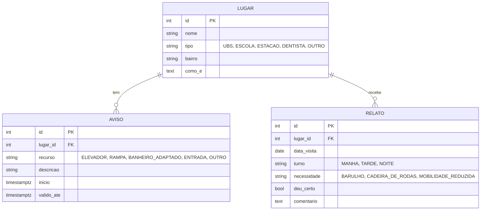
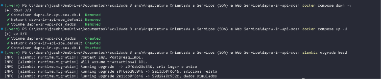
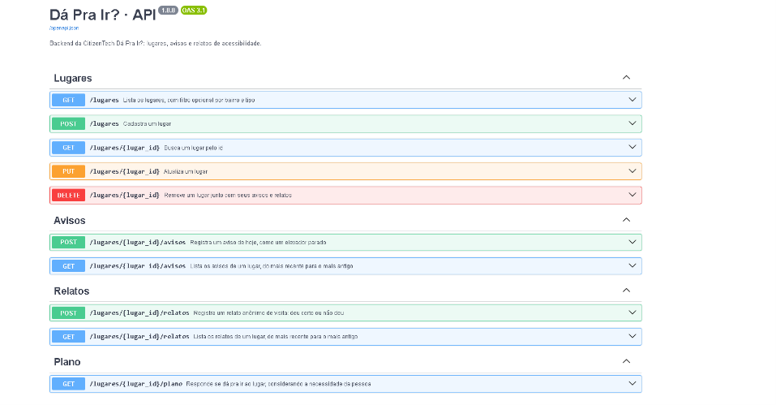
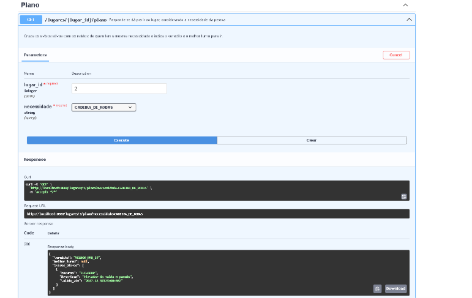
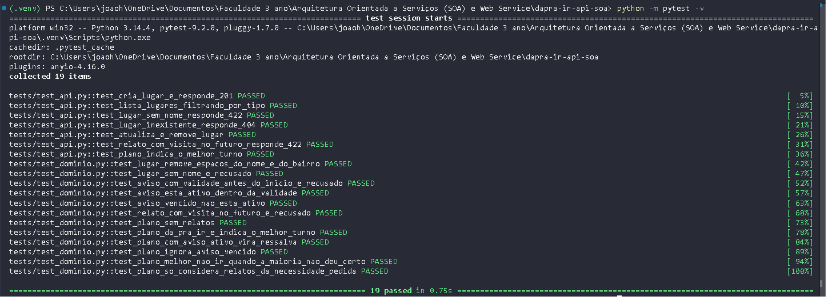

# Dá Pra Ir? · API

> Backend da CitizenTech **Dá Pra Ir?**, entregue na Global Solution 2026.2 da disciplina de **Arquitetura Orientada a Serviços (SOA) e Web Services**, FIAP.

Uma API REST que responde, antes de sair de casa, a pergunta que pessoas com deficiência, pessoas autistas e famílias atípicas fazem toda vez: **esse lugar vai funcionar pra mim?**

---

## Sumário

1. [Integrantes](#integrantes)
2. [Ficha da CitizenTech](#ficha-da-citizentech)
3. [Tecnologias](#tecnologias)
4. [Arquitetura](#arquitetura)
5. [Modelo de dados](#modelo-de-dados)
6. [Regras de negócio](#regras-de-negócio)
7. [Endpoints](#endpoints)
8. [Como executar](#como-executar)
9. [Migrações](#migrações)
10. [Documentação da API](#documentação-da-api)
11. [Testes](#testes)
12. [De onde vêm os dados](#de-onde-vêm-os-dados)
13. [Decisões de projeto](#decisões-de-projeto)
14. [Evidências](#evidências)

---

## Integrantes

**Turma:** 3ESPX

| Nome | RM |
|---|---|
| Carlos Henrique | RM558003 |
| Mauricio Alves | RM556214 |
| Ian Monteiro | RM558652 |
| Bruno Silva | RM550416 |
| João Hoffmann | RM550763 |

---

## Ficha da CitizenTech

| | |
|---|---|
| **Nome** | Dá Pra Ir? |
| **Cidade e região** | São Paulo (SP), região da AACD e dos hospitais, com foco na jornada de levar a criança às consultas e terapias |
| **Cidadão beneficiado** | Pessoas com deficiência, pessoas autistas e famílias atípicas |
| **Problema, em uma frase** | Pessoas com deficiência, pessoas autistas e famílias atípicas não sabem, antes de sair de casa, se um lugar vai funcionar para elas. |
| **Como funciona** | Cada lugar (UBS, escola, estação, dentista) tem uma ficha com **como é** (descrição prática do lugar), **como está** (avisos com validade, como um elevador parado) e **como foi** (relatos anônimos de quem já foi: deu certo ou não deu). A pessoa informa a sua necessidade, sem precisar de diagnóstico, e recebe um plano: se dá pra ir, o melhor turno e os avisos ativos. |
| **O que esta parte faz** | Este repositório é o **backend**: guarda os dados e as regras e expõe tudo por um contrato OpenAPI, que o app da equipe consome. |
| **Repositório** | https://github.com/JoaoHHoffmann/dapra-ir-api-soa |
| **Indicador de impacto** | Taxa de "deu certo" por lugar e necessidade (relatos com `deu_certo = true` ÷ total de relatos) e quantidade de dias com aviso ativo por recurso (elevador, rampa, banheiro adaptado). |

### ODS conectados

- **ODS 3 · Saúde e bem-estar.** Antes de uma consulta ou terapia, a família consulta o plano do lugar e descobre o melhor turno e os avisos ativos. Isso reduz idas perdidas e situações de sobrecarga numa sala de espera barulhenta.
- **ODS 10 · Redução das desigualdades.** A API reúne, num serviço aberto, uma informação que hoje fica espalhada em grupos de mensagens: relatos anônimos de quem tem a mesma necessidade (barulho, cadeira de rodas, mobilidade reduzida), sem exigir diagnóstico nem dado pessoal.
- **ODS 11 · Cidades e comunidades sustentáveis.** Cada aviso de recurso parado fica registrado com início e validade, e cada relato "não deu" fica guardado. Esse histórico é a base para mostrar à Prefeitura quanto tempo um problema de acessibilidade ficou sem solução.

---

## Tecnologias

| Para quê | Ferramenta |
|---|---|
| Linguagem | Python 3.11 ou superior (testado com 3.13 e 3.14) |
| API REST e documentação automática | FastAPI e Uvicorn |
| Banco de dados | PostgreSQL 16, via Docker Compose |
| Acesso a dados (ORM) | SQLAlchemy 2 e psycopg 3 |
| Migrações | Alembic |
| Configuração por ambiente | python-dotenv |
| Testes | pytest e httpx2 |

---

## Arquitetura

O projeto usa uma **arquitetura em camadas com o domínio isolado, inspirada em DDD**, e é exposto como **um serviço REST**: ele é dono dos próprios dados, e os outros sistemas só falam com ele pelo contrato OpenAPI.

```
API (rotas, DTOs, status HTTP)
   ↓
Aplicação (casos de uso)
   ↓
Domínio (entidades e regras, Python puro, sem framework)
   ↑
Infraestrutura (SQLAlchemy, banco)
```

- **Domínio** não importa FastAPI nem SQLAlchemy. As regras ficam dentro das entidades e são testadas sem banco e sem HTTP.
- **Aplicação** orquestra os casos de uso: busca no banco, converte para o domínio e grava o resultado.
- **API** recebe e devolve DTOs. A entidade do banco nunca vai direto para o JSON.
- **Infraestrutura** cuida da conexão e do mapeamento das tabelas.

```
dapra-ir-api-soa/
├── app/
│   ├── dominio/          lugar.py, aviso.py, relato.py, plano.py, erros.py   ← regras
│   ├── aplicacao/        lugares.py, avisos.py, relatos.py, planos.py         ← casos de uso
│   ├── infraestrutura/   db.py, modelos.py                                    ← banco
│   └── api/              esquemas.py, rotas_*.py                              ← HTTP
├── migrations/           env.py, versions/                                    ← Alembic
├── tests/                test_dominio.py, test_api.py
├── main.py               cria a API e traduz erros em status HTTP
├── docker-compose.yml    PostgreSQL 16
├── requirements.txt
└── .env.example
```

---

## Modelo de dados



- **Lugar 1–N Aviso** e **Lugar 1–N Relato**, ligados por chave estrangeira.
- O relato **não tem nenhum campo que identifique a pessoa**: é anônimo por padrão.

---

## Regras de negócio

Todas ficam em `app/dominio/` e estão cobertas por testes de unidade.

| Regra | Onde |
|---|---|
| Um lugar precisa ter nome e bairro (espaços sobrando são removidos) | `lugar.py` |
| A validade de um aviso precisa ser depois do início | `aviso.py` |
| Um aviso só vale dentro da validade: aviso vencido não entra no plano | `aviso.py` (`esta_ativo`) |
| A data da visita de um relato não pode estar no futuro | `relato.py` |
| O plano considera só os relatos da necessidade informada e indica o turno com mais "deu certo" (em empate, o mais cedo) | `plano.py` |

Quando uma regra é quebrada, a API responde **422** com a mensagem do domínio.

### Como o plano decide o veredito

| Situação | Veredito |
|---|---|
| Nenhum relato para a necessidade informada | `SEM_RELATOS` |
| Mais da metade dos relatos disse "não deu" | `MELHOR_NAO_IR` |
| A maioria deu certo, mas há aviso ativo | `DA_PRA_IR_COM_RESSALVAS` |
| A maioria deu certo e não há aviso ativo | `DA_PRA_IR` |

---

## Endpoints

| Método | Caminho | O que faz |
|---|---|---|
| GET | `/lugares` | Lista os lugares, com filtro opcional por `bairro` e `tipo`, ordenados por nome |
| POST | `/lugares` | Cadastra um lugar |
| GET | `/lugares/{lugar_id}` | Busca um lugar |
| PUT | `/lugares/{lugar_id}` | Atualiza um lugar |
| DELETE | `/lugares/{lugar_id}` | Remove um lugar junto com seus avisos e relatos |
| POST | `/lugares/{lugar_id}/avisos` | Registra um aviso, como um elevador parado |
| GET | `/lugares/{lugar_id}/avisos` | Lista os avisos do lugar, do mais recente para o mais antigo |
| POST | `/lugares/{lugar_id}/relatos` | Registra um relato anônimo: deu certo ou não deu |
| GET | `/lugares/{lugar_id}/relatos` | Lista os relatos do lugar, do mais recente para o mais antigo |
| GET | `/lugares/{lugar_id}/plano?necessidade=` | Responde se dá pra ir, com o melhor turno e os avisos ativos |

### Códigos de resposta

| Código | Quando |
|---|---|
| 200 / 201 / 204 | Sucesso |
| 404 | O lugar não existe |
| 422 | Dados em formato inválido ou regra do domínio violada |

### Exemplo: o plano "dá pra ir?"

Com os dados simulados, para a estação e uma pessoa que usa cadeira de rodas:

```
GET /lugares/2/plano?necessidade=CADEIRA_DE_RODAS
```

```json
{
  "veredito": "MELHOR_NAO_IR",
  "melhor_turno": null,
  "avisos_ativos": [
    {
      "recurso": "ELEVADOR",
      "descricao": "Elevador da saída B parado",
      "valido_ate": "2027-12-31T23:00:00Z"
    }
  ]
}
```

---

## Como executar

### Pré-requisitos

- Python 3.11 ou superior
- Docker Desktop
- Git

### Passo a passo

**1. Clone o repositório**

```bash
git clone https://github.com/JoaoHHoffmann/dapra-ir-api-soa.git
cd dapra-ir-api-soa
```

**2. Crie e ative o ambiente virtual e instale as dependências**

```bash
python -m venv .venv
source .venv/bin/activate          # no Windows: .venv\Scripts\activate
pip install -r requirements.txt
```

**3. Crie o arquivo `.env` a partir do exemplo**

```bash
cp .env.example .env               # no Windows: copy .env.example .env
```

Troque `troque-esta-senha` pela senha que quiser, **nas duas linhas**. Use só letras, números, `-` ou `_`: os caracteres `@`, `%` e `:` quebram a URL de conexão.

**4. Suba o banco**

```bash
docker compose up -d
```

**5. Crie as tabelas e carregue os dados simulados**

```bash
alembic upgrade head
```

**6. Suba a API**

```bash
uvicorn main:app --reload
```

A documentação abre em **http://localhost:8000/docs**.

---

## Migrações

O esquema do banco é criado **só por migrações** (Alembic), nunca pelo ORM ao subir a aplicação.

| Ordem | Migração | O que faz |
|---|---|---|
| 1 | `cria lugar e aviso` | Cria as tabelas `lugar` e `aviso`, com chave estrangeira e índices |
| 2 | `adiciona relato` | Evolução do esquema: cria a tabela `relato` |
| 3 | `dados simulados` | Carrega 3 lugares, 2 avisos e 5 relatos fictícios |

### Criar o banco do zero

```bash
docker compose down -v      # apaga o banco e os dados
docker compose up -d        # sobe um banco vazio
alembic upgrade head        # aplica as 3 migrações
```

Outros comandos úteis:

```bash
alembic history             # lista a sequência de migrações
alembic downgrade -1        # desfaz a última migração
```

---

## Documentação da API

A documentação é gerada automaticamente a partir do código, com a API rodando:

| O quê | Endereço |
|---|---|
| Swagger UI | http://localhost:8000/docs |
| ReDoc | http://localhost:8000/redoc |
| Contrato OpenAPI | http://localhost:8000/openapi.json |

Todos os endpoints têm resumo, estão agrupados por tag (**Lugares, Avisos, Relatos, Plano**), trazem exemplos de entrada e saída e documentam os erros 404 e 422.

O print da documentação está em [Evidências](#evidências).

---

## Testes

```bash
python -m pytest -v
```

São **19 testes**:

- **12 testes de unidade do domínio** (`tests/test_dominio.py`): rodam sem banco e sem HTTP e cobrem todas as regras de negócio e os quatro vereditos do plano.
- **7 testes da API** (`tests/test_api.py`): sobem a aplicação e conferem status e corpo das respostas, incluindo o CRUD de Lugar, os erros 404 e 422 e o plano.

Os testes da API usam um banco **SQLite em memória**, criado do zero a cada teste. Por isso eles não precisam do Docker e não mexem no banco de verdade, que continua vindo das migrações.

O print da saída dos testes está em [Evidências](#evidências).

---

## De onde vêm os dados

**Todos os dados do repositório são simulados e foram criados pela equipe.** O bairro "Jardim Esperança" e os lugares cadastrados são fictícios, e não há nenhum dado pessoal real.

Os relatos são anônimos por padrão: a API não guarda nome, contato ou qualquer informação que identifique quem fez o relato.

---

## Decisões de projeto

- **Remover um lugar remove junto os seus avisos e relatos.** Um aviso ou relato sem lugar não tem significado.
- **Toda data com hora precisa ter fuso horário**, por exemplo `2026-11-14T08:00:00Z`. Uma data sem fuso volta 422. O banco grava em `TIMESTAMPTZ` e o domínio compara tudo em UTC.
- **Toda informação tem validade.** O aviso tem `valido_ate` e, depois disso, deixa de contar no plano. Isso responde ao maior risco do projeto: o app ficar desatualizado.
- **As regras não dependem do relógio.** O plano recebe o "agora" como parâmetro: na API é a hora real e nos testes é uma data fixa, o que deixa os testes previsíveis.
- **Os testes da API não cobrem os avisos.** O SQLite não guarda fuso horário. A regra dos avisos (validade, vencimento e ressalva no plano) está coberta pelos testes de domínio.

---

## Evidências

### 1. Migrações aplicadas do zero



### 2. Documentação Swagger



### 3. API respondendo o plano "dá pra ir?"

`GET /lugares/2/plano?necessidade=CADEIRA_DE_RODAS` respondendo `MELHOR_NAO_IR`, com o aviso do elevador.



### 4. Testes passando

